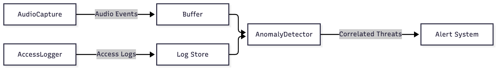
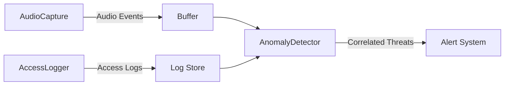

# EchoTrace MVP

Correlates physical audio anomalies with digital access logs to identify insider threats.

## Setup
pip install -r requirements.txt

## Run Demo
python main.py

## Run Tests
pytest -q

## Architecture

Mermaid source

